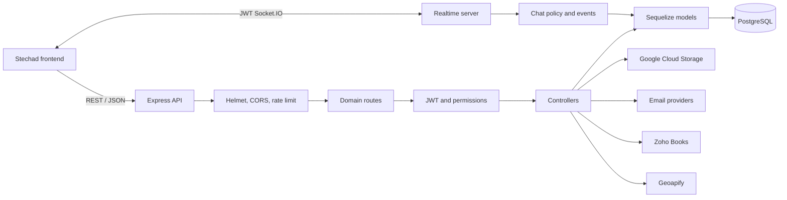

# STECHAD Backend

The STECHAD backend is the REST and realtime API for the STECHAD talent, project, staffing, and administration platform. It combines a modular Express application with Sequelize/PostgreSQL persistence and Socket.IO chat.

## Table of Contents

- [Platform Capabilities](#platform-capabilities)
- [Technology Stack](#technology-stack)
- [Architecture](#architecture)
- [Prerequisites](#prerequisites)
- [Local Setup](#local-setup)
- [Environment Variables](#environment-variables)
- [Database and Migrations](#database-and-migrations)
- [Running the Application](#running-the-application)
- [API Documentation](#api-documentation)
- [Main API Areas](#main-api-areas)
- [Authentication and Authorization](#authentication-and-authorization)
- [Realtime Messaging](#realtime-messaging)
- [Integrations](#integrations)
- [Testing](#testing)
- [Deployment](#deployment)
- [Project Structure](#project-structure)
- [Operational Notes](#operational-notes)
- [Troubleshooting](#troubleshooting)

## Platform Capabilities

- Talent registration, onboarding, profile management, vetting, and invitations
- Job publishing, applications, applicant review, interviews, and hiring workflows
- Project creation, project-manager assignment, project membership, and invoicing
- Admin dashboards, workforce management, custom roles, and database-backed permissions
- Staff attendance, location-aware clock-ins, leave requests, expense claims, holidays, and KPIs
- Direct and group chat with typing indicators, presence, read receipts, and message history
- Notifications, referrals, reward tracking, analytics, audit logs, and data exports
- Google OAuth, OTP/password recovery, access tokens, refresh tokens, and session invalidation
- Google Cloud Storage uploads and Zoho Books billing integrations

## Technology Stack

| Area | Technology |
|---|---|
| Runtime | Node.js |
| HTTP framework | Express 4 |
| Database | PostgreSQL through Sequelize 6 |
| Realtime | Socket.IO 4 |
| Authentication | JSON Web Tokens, Passport Google OAuth |
| Validation | express-validator |
| Uploads | Multer |
| Object storage | Google Cloud Storage |
| Email | Nodemailer, Node Mailjet |
| API documentation | Swagger UI / OpenAPI |
| Security | Helmet, CORS, rate limiting |
| Migrations | Umzug plus Sequelize CLI |
| Testing | Node test runner with integration helpers |

## Architecture

The backend is a modular Express monolith. REST handlers and Socket.IO share one HTTP server and the same PostgreSQL models.



Startup performs database authentication, role/chat storage reconciliation, migration execution, audit-hook installation, default reward seeding, scheduler startup, and HTTP server initialization.

For a detailed code-level architecture, data model, startup sequence, and permission design, see [docs/architecture.md](docs/architecture.md).

## Prerequisites

- Node.js 18 or newer
- npm
- PostgreSQL 13 or newer
- A Google Cloud Storage bucket and credentials for file features
- SMTP or Mailjet credentials for email features
- Optional: Google OAuth credentials, Zoho Books OAuth credentials, and a Geoapify API key

## Local Setup

1. Enter the backend directory:

   ```bash
   cd stechad-backend
   ```

2. Install dependencies:

   ```bash
   npm install
   ```

3. Create PostgreSQL databases for your development and test environments.

4. Create environment configuration:

   ```bash
   cp .env.example .env
   ```

5. Replace placeholder values, especially database, JWT, email, and integration credentials.

6. Run migrations:

   ```bash
   npm run db:migrate
   ```

7. Seed system roles:

   ```bash
   npm run seed:roles
   ```

8. Optionally create a super admin:

   ```bash
   npm run seed:super-admin
   ```

9. Start the API:

   ```bash
   npm run dev
   ```

The default API port is `5000`. The API root is `http://localhost:5000/`, and Swagger UI is available at `http://localhost:5000/api-docs`.

> Development database settings are also present in `config/config.js`. Do not use its example credentials in production. Production startup requires `DATABASE_URL`.

## Environment Variables

Create a local `.env` file and never commit real credentials.

### Core

| Variable | Purpose |
|---|---|
| `NODE_ENV` | `development`, `test`, or `production` |
| `PORT` | HTTP and Socket.IO server port; defaults to `5000` |
| `DATABASE_URL` | PostgreSQL connection URL; required in production |
| `DB_SCHEMA` | PostgreSQL schema; defaults to `public` |
| `JWT_SECRET` | Access-token signing secret |
| `JWT_ACCESS_EXPIRATION` | Managed access-token lifetime; defaults to `15m` |
| `AUTH_SESSION_LIFETIME_SECONDS` | Device-session lifetime; defaults to 86400 seconds, bounded to 60–2592000 |
| `JWT_REFRESH_SECRET` | Signing secret retained for the finite legacy refresh exchange |
| `PLATFORM_MFA_ENCRYPTION_KEY` | Dedicated 32-byte base64 key for platform authenticator secrets |
| `FRONTEND_URL` | Primary frontend origin allowed by CORS |
| `FRONTEND_PROD_URL` | Optional production frontend origin |
| `BACKEND_URL` | Optional primary backend origin |
| `BACKEND_PROD_URL` | Optional production backend origin |

### Email

| Variable | Purpose |
|---|---|
| `EMAIL_HOST` | SMTP server |
| `EMAIL_PORT` | SMTP port |
| `EMAIL_USER` | SMTP username |
| `EMAIL_PASS` | SMTP password |
| `MAIL_FROM_NAME` | Sender display name |
| `MJ_APIKEY_PUBLIC` | Mailjet public API key |
| `MJ_APIKEY_PRIVATE` | Mailjet private API key |

### Storage and file uploads

| Variable | Purpose |
|---|---|
| `GOOGLE_APPLICATION_CREDENTIALS` | Credential JSON in production or credential-path setting from the environment |
| `GCS_BUCKET_NAME` | Google Cloud Storage bucket |
| `UPLOAD_PATH` | Local upload path used by upload utilities |
| `MAX_FILE_SIZE` | Maximum configured upload size |

The development GCS helper looks for `config/googleServiceKey.json`. The production helper expects credential JSON in the environment.

### Authentication and integrations

| Variable | Purpose |
|---|---|
| `GOOGLE_CLIENT_ID` | Google OAuth client ID |
| `GOOGLE_CLIENT_SECRET` | Google OAuth client secret |
| `ACCEPT_BEARER_AUTH` | Bearer-auth behavior override |
| `COOKIE_SECURE` | Enable secure cookies |
| `GEOAPIFY_API_KEY` | Reverse-geocoding API key |
| `GEOAPIFY_TIMEOUT_MS` | Reverse-geocoding timeout |

The `.env.example` file also documents Zoho Books variables:

- `ZOHO_CLIENT_ID`
- `ZOHO_CLIENT_SECRET`
- `ZOHO_REFRESH_TOKEN`
- `ZOHO_ORGANIZATION_ID`
- `ZOHO_DEFAULT_ITEM_ID`
- `ZOHO_ACCOUNTS_URL`
- `ZOHO_API_BASE_URL`

Super-admin seeding requires:

- `SUPER_ADMIN_EMAIL`
- `SUPER_ADMIN_PASSWORD`
- `SUPER_ADMIN_FIRST_NAME`
- `SUPER_ADMIN_LAST_NAME`

## Database and Migrations

Sequelize is configured in `config/database.js` and `config/config.js`. Development uses PostgreSQL by default. Production requires `DATABASE_URL` and enables SSL-compatible dialect settings.

Available migration commands:

```bash
npm run db:migrate
npm run db:migrate:status
npm run db:migrate:undo
```

Versioned migration files live in `migrations/`. Applied migrations are recorded in `SequelizeMeta`.

Startup also runs idempotent compatibility steps for:

- Role storage and custom role permissions
- Chat storage and chat lifecycle fields
- Email normalization
- Permanent account-deletion support

Prefer migrations for all schema changes. Automatic model synchronization is not the startup mechanism.

## Running the Application

Development with automatic restart:

```bash
npm run dev
```

Production-style startup:

```bash
npm start
```

Server startup exits if database initialization or migrations fail.

### Health Checks

| Endpoint | Purpose |
|---|---|
| `GET /api/health` | API readiness and health |
| `GET /` | Base server response |
| `GET /api-docs` | Swagger UI |
| `GET /api-docs.json` | Swagger specification JSON |

## API Documentation

Swagger UI is mounted at `/api-docs`. The raw generated specification is available at `/api-docs.json`.

Protected endpoints expect a bearer token:

```http
Authorization: Bearer <access-token>
```

The API emits JSON responses. Common response shapes include an `success` flag, `data`, `message`, validation `errors`, or permission `blockers`.

## Main API Areas

| Prefix | Responsibility |
|---|---|
| `/api/auth` | Registration, login, refresh, logout, OTP, password reset, invitations, Google OAuth |
| `/api/platform` | Explicit platform grants, MFA and sanitized global administration |
| `/api/talents` | Talent onboarding and role-specific profile/dashboard operations |
| `/api/pm` | Project-manager profile and dashboard operations |
| `/api/admin` | Administration, users, vetting, settings, roles, and audits |
| `/api/jobs` | Job catalog operations |
| `/api/applications` | Applicant and application workflow operations |
| `/api/projects` | Project management |
| `/api/interviews` | Interview scheduling and updates |
| `/api/staff` | Attendance, leave, expenses, invoices, KPIs, holidays, and staff profiles |
| `/api/workforce/management` | Delegated staffing and workforce operations |
| `/api/analytics` | Platform and workforce analytics |
| `/api/export` | CSV, Excel, and JSON exports |
| `/api/chat` | Chats, messages, conversation state, read state, and membership |
| `/api/notifications` | Personal notifications and broadcast notifications |
| `/api/upload` | Managed file uploads and removal |
| `/api/referrals` | Referrals, rewards, claims, and leaderboard |

Route implementations are in `routes/`; use-case logic is in `controllers/`; database entities are in `models/`.

## Authentication and Authorization

### Identity

Bearer access tokens identify a live managed device session. Authentication checks the global identity, session expiry/revocation and account session version before resolving HR membership. Refresh credentials are opaque, stored as hashes and rotated once; logout revokes the current device, while logout-all and password changes invalidate older sessions. Google sign-in uses a state-bound authorization code with PKCE.

See [managed sessions](docs/managed-sessions.md) for session endpoints and the migration-anchored legacy-token transition. Both standalone and serverless composition require verified tenancy and activated session storage before serving application requests.

### Roles

Built-in role keys include:

- `super_admin`
- `admin`
- `project_manager`
- `staff`
- `talent`

Custom workforce roles are stored in `Role` and `RolePermission`. Super admins inherit the endpoint permissions granted to admins.

These are HR roles within an organization. Platform authority requires a separate explicit grant and fresh session-bound MFA; organization ownership and HR super-admin status confer no platform access. The separate frontend entry is `/platform-admin.html`. See [platform administration](docs/platform-administration.md) for bootstrap, key configuration and API operations.

### Workforce permissions

Database-backed permission keys include staffing, department, KPI, leave, expense, receipt, invoice, and project-related capabilities. Permission checks are enforced by middleware and are also reflected in API response blockers.

### Audit and account lifecycle

Audit hooks track model mutations after migrations. Account deactivation, soft deletion, session invalidation, and permanent deletion follow the user-management lifecycle documented in [docs/architecture.md](docs/architecture.md).

## Realtime Messaging

REST chat endpoints and Socket.IO run on the same Node server. Socket.IO CORS permits a wildcard for the realtime server while REST CORS is constrained by configured frontend origins.

The realtime layer supports:

- Authenticated user rooms
- Direct and group messages
- Typing indicators
- Online/presence state
- Read receipts
- Chat and notification updates
- Account-update events

Socket.IO connection authentication uses the access token. The frontend should connect to the backend origin rather than the REST path when configuring a separate Socket.IO URL.

## Integrations

### Google Cloud Storage

Uploads are validated by Multer and stored in GCS. Read URLs are signed and expire. Configure either `config/googleServiceKey.json` locally or credential JSON through `GOOGLE_APPLICATION_CREDENTIALS` in production.

### Email

Nodemailer and Node Mailjet support account verification, password recovery, invitations, and operational notifications. Transactional templates are stored in `templates/`.

### Google OAuth

Passport Google OAuth provides browser-based sign-in. Configure the Google client credentials and allow the deployed backend callback URL in Google Cloud.

### Zoho Books

The backend includes invoice integration using the Zoho Books OAuth refresh-token flow. Configure the organization, item, account URL, and API base URL for the organization's data center.

### Geoapify

Staff location workflows can reverse geocode browser coordinates into city/state/country information.

## Testing

Run the complete Node test suite:

```bash
npm test
```

The suite contains integration and migration tests for:

- Authentication and email normalization
- Chat lifecycle and storage migration
- Custom role permissions
- Talent terminology migration
- User-management migrations
- User lifecycle and soft/permanent deletion
- Workforce associations
- Workforce settings and birthdays

Some tests require PostgreSQL and environment-specific database configuration. Review each test's setup before running against a shared database.

## Deployment

The backend can run as a traditional Node process or as a Vercel-exported HTTP server.

For a traditional host or container:

1. Set `NODE_ENV=production`.
2. Set `DATABASE_URL`, JWT secrets, CORS origins, and all required integrations.
3. Set `DB_SCHEMA` if the database uses a schema other than `public`.
4. Install dependencies and run migrations.
5. Start with `npm start`.

For Vercel, `server.js` exports the HTTP server and startup migrations depend on the `VERCEL` environment guard. Ensure the deployed environment has sufficient database and function timeout capacity for migrations and scheduled work.

Recommended production checks:

- Use strong, unique JWT secrets.
- Use HTTPS for REST and Socket.IO.
- Restrict CORS to deployed frontend and backend origins.
- Do not commit credential JSON or `.env`.
- Use least-privilege GCS credentials.
- Back up PostgreSQL before migrations.
- Configure application-level logging and database monitoring.

## Project Structure

```text
stechad-backend/
├── server.js               # Application composition and startup
├── config/                 # Database, Swagger, OAuth, and GCS configuration
├── controllers/            # REST use-case handlers
├── routes/                 # Express route declarations
├── middleware/             # Auth, permissions, validation, uploads
├── models/                 # Sequelize models and associations
├── migrations/             # Versioned schema and data migrations
├── seeders/                # Roles, super admin, and rewards
├── scripts/                # Maintenance scripts
├── utils/                  # Chat, audit, schedulers, integrations, permissions
├── templates/              # Email templates
├── test/                   # Node integration and migration tests
├── docs/                   # Architecture and workforce documentation
└── uploads/                # Local uploaded-file workspace
```

## Operational Notes

- REST and Socket.IO share the same access-token identity model.
- The API applies a 5 MB JSON request limit and a `1000`-request-per-two-minute IP limiter on `/api/*`.
- Background schedulers start after database initialization:
  - Holiday notifications
  - Attendance closing
- Chat mutations publish realtime events after state changes.
- Signed GCS URLs typically expire after seven days.
- Migration and reconciliation steps are designed for existing installations and should be monitored during startup.

## Troubleshooting

### Database connection fails

- Confirm PostgreSQL is running.
- Verify host, port, database, username, password, and schema.
- In production, confirm `DATABASE_URL` is set.
- Use `npm run db:migrate:status` to inspect migration state.

### `JWT_SECRET` or token errors

- Ensure `JWT_SECRET` is set consistently across all backend instances.
- Set separate `JWT_SECRET` and `JWT_REFRESH_SECRET` values.
- If session invalidation appears unexpectedly, verify that `session_version` has not changed.

### CORS origin blocked

- Set `FRONTEND_URL` and/or `FRONTEND_PROD_URL`.
- Include the deployed frontend origin with protocol.
- Do not add `/api` to the frontend origin unless it is part of the actual browser origin.

### Swagger assets do not load

- Confirm the server can reach the configured jsDelivr CDN.
- For an offline environment, self-host Swagger UI assets or adjust `server.js`.

### GCS uploads fail

- Verify `GCS_BUCKET_NAME`.
- Confirm credential JSON or `config/googleServiceKey.json`.
- Confirm the service account can write objects and generate signed URLs.

### Email sends fail

- Verify SMTP or Mailjet credentials.
- Confirm the provider permits the selected sender and region.
- Check provider logs and the backend console.
