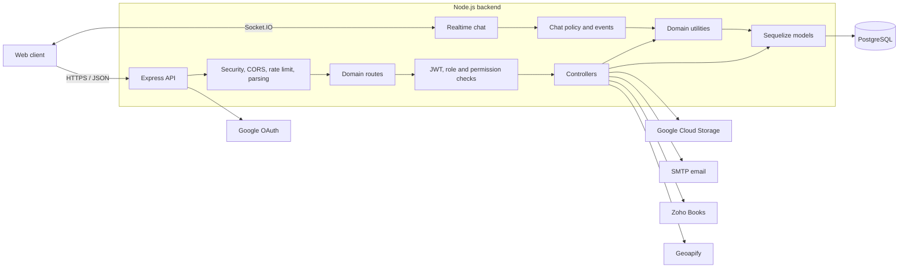
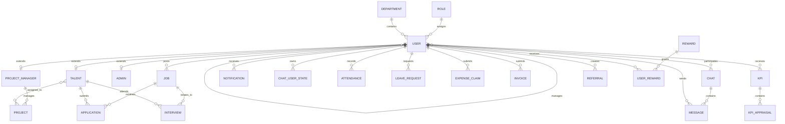
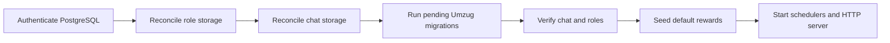

# Backend Architecture

## Overview

The backend is a modular Express monolith. REST APIs and Socket.IO run on the same Node.js HTTP server, use the same JWT identity model, and persist data through Sequelize to PostgreSQL.

## Request flow

1. `server.js` applies Helmet, CORS, compression, rate limiting, and body parsing.
2. A route under `/api/*` validates input and applies authentication or authorization middleware.
3. The controller coordinates the use case and calls Sequelize models or a domain utility.
4. Sequelize reads or writes PostgreSQL. Uploads are streamed to Google Cloud Storage and exposed with signed URLs.
5. Chat and notification changes are also published to authenticated Socket.IO user rooms.

## Main modules

| Area | Routes | Main responsibility |
|---|---|---|
| Identity | `/api/auth` | Signup, login, refresh tokens, invitations, password flows, Google OAuth |
| Talent | `/api/talents` | Onboarding, profiles, jobs, applications, assigned projects |
| Project management | `/api/pm`, `/api/jobs`, `/api/applications`, `/api/projects`, `/api/interviews` | Job publishing, hiring workflow, project assignment and interviews |
| Administration | `/api/admin`, `/api/analytics`, `/api/export` | Platform administration, workforce data, roles, settings, reporting and exports |
| Workforce | `/api/staff` | Attendance, leave, expenses, invoices, KPI appraisals, holidays and profiles |
| Messaging | `/api/chat`, `/api/notifications`, Socket.IO | Direct/group chat, membership, message state and realtime notifications |
| Supporting features | `/api/upload`, `/api/referrals` | Managed uploads, referrals and rewards |

Swagger UI is served at `/api-docs`; health checks are available at `/api/health` and `/`.

## Data architecture

`User` is the central identity. `Role` controls the stored role, while `Talent`, `ProjectManager`, and `Admin` extend a user with role-specific data.

Chat membership is stored through `ChatParticipants`; `ChatUserState` stores each participant's personal clear/delete and read boundaries. The `talent_project` join table stores Talent-to-Project assignments.

## Security and permissions

- Access tokens are JWTs. `authenticate` resolves the active user for every protected request.
- `authorize` enforces the role keys `super_admin`, `admin`, `project_manager`, `staff`, and `talent`.
- Workforce actions add database-backed permissions through `RolePermission`, with per-user overrides.
- Chat applies its own centralized contact, membership, posting, and visibility policies to both REST and Socket.IO operations.
- Multer validates uploads in memory and enforces a 2 MB limit before storage in GCS.

## Realtime and background processing

- Socket.IO authenticates the connection with JWT, tracks online users, and uses `user_<id>` rooms for personal events.
- Chat events include sending, typing, read receipts, presence, membership updates, and notification changes.
- Holiday notification and attendance auto-close schedulers start after database initialization.

## Database startup and migrations

Startup follows this order:

Versioned Sequelize migrations live in `migrations/` and are recorded in `SequelizeMeta`. The role and chat reconcilers are idempotent compatibility steps for fresh and upgraded installations. Automatic `sequelize.sync()` is currently disabled, so schema changes should be delivered as migrations.

## Code layout

| Path | Purpose |
|---|---|
| `server.js` | Application composition, middleware, routes, Socket.IO and startup |
| `routes/` | HTTP contracts and endpoint-level middleware |
| `controllers/` | Use-case orchestration and response formatting |
| `models/` | Sequelize entities and associations |
| `utils/` | Chat, notifications, roles, schedulers and external-service helpers |
| `middleware/` | Authentication, authorization, validation and uploads |
| `migrations/` | Transactional schema and stored-value changes |
| `seeders/` | System roles, super admin and default rewards |
| `templates/` | Transactional email templates |
| `test/` | Node and PostgreSQL integration tests |

## Integrated account and workforce controls

See [User management and personal preferences](user-management.md) for the soft-deletion lifecycle, audit storage, session versions, personal clock-out and sound settings, location consent transactions, reporting-manager provenance, delegated management APIs, and notification broadcasts. `utils/permissions.js` is the shared permission catalog and resolver. Audit hooks are installed after migrations; model mutations and audit inserts share a transaction, and notification publication runs after commit.
