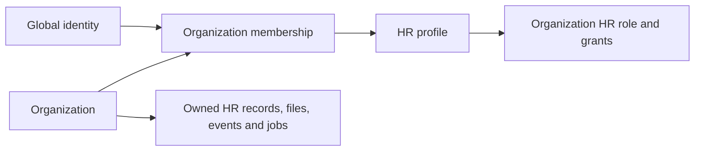

# Phase 1 implementation

Both repositories use `phase1-tenancy-integration`. The existing HR product remains in place; this phase adds organization ownership and separates global identity from HR access. Nothing has been deployed and the application database has not been migrated.

Existing users, roles, grants, history and file references migrate into stechad. The migration freezes its legacy identity population so reruns cannot enroll future users from other organizations. Organization-specific HR profiles hold employment, reporting, preferences and reward balances. Removing HR access preserves the global account and its other memberships.

Organization APIs provide creation, listing, settings, invitations, membership changes and leaving, with transactional last-owner protection. Existing invitees authenticate with the matching verified identity; new invitees create credentials using a single-use emailed token. Frontend selection is per tab, resets tenant providers/caches, rejects old responses and reconnects sockets with explicit organization ownership. Unavailable HR membership returns to selection without signing out the global identity.

Workforce, recruitment, projects, referrals, rewards, chat, notifications, files, reports and background work use validated ownership. Shared-account tests exercise different HR roles in two organizations. Socket delivery revalidates recipients; deferred events wait for the outer transaction and do not publish rolled-back writes. Legacy Zoho credentials are restricted to stechad.

## Validation

- Full backend regression: 120 tests passed, zero skipped, using disposable schemas in an isolated local PostgreSQL cluster. Subsequent notification transaction fixes additionally passed three jobs/audit tests, four tenant Socket.IO/chat tests and a legacy broadcast test.
- Frontend: 19 suites / 87 tests passed; production build passed. Headless Chrome exercised switching, keyboard/mobile behavior, independent tabs, delayed responses, membership revocation, no-HR membership and existing-account invitation acceptance against controlled HTTP fixtures.
- Migration rehearsal: dry-run, apply twice, verify, stable identifiers/hashes/grants, deleted/orphan history, pending invitations and file references; future organization identities remain outside the stechad backfill. Runtime readiness rejects a missing checkpoint.
- Existing frontend debt remains: typecheck has 20 baseline errors; lint has 41 baseline errors and 15 warnings. Comparison against the original baseline found no new failures. These checks are not reported as passing.

## Cutover boundary

Follow [the migration runbook](tenancy-foundation.md) and [organization API contract](organization-memberships.md). Back up and rehearse against a production-like copy, drain old writers, run existing versioned migrations, apply the explicit tenancy migration and verify before starting the new server. Runtime HR access fails closed until verification succeeds. Retained orphan history is reported and preserved; cross-organization references fail verification.

Organization creation remains disabled by default (`ENABLE_ORGANIZATION_CREATION`). New owners receive a basic staff HR profile; existing stechad HR super-admin access remains intact. Automatic approval review rejected automatic HR super-admin provisioning as persistent privilege escalation, so trusted HR-role provisioning and production enablement remain an explicit operator decision. No platform-wide privileges are inferred.

Live Google OAuth, email, GCS and Zoho production integrations were not exercised. External transports were controlled in tests. Existing signed file URLs remain valid until their configured expiry. Production cutover and all later roadmap phases require separate review; this implementation does not enable subscriptions or new suite products.
